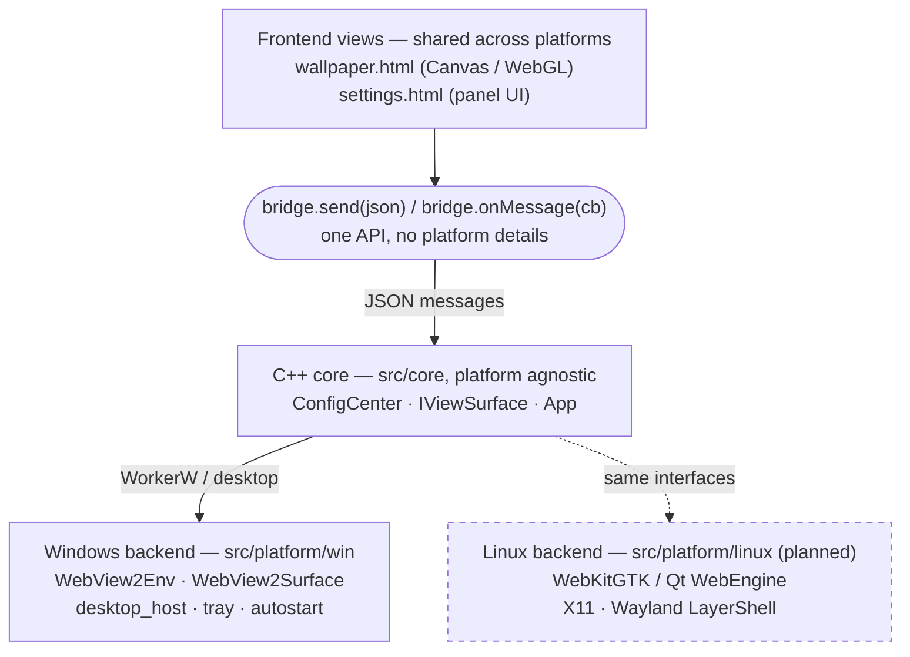

<p align="center">
  
</p>

# Fleeting Light

A WebView-based live wallpaper engine. The frontend is plain HTML/Canvas/WebGL, the core and
platform backends are C++. On Windows the wallpaper is rendered by **WebView2** and parented
under the desktop's `WorkerW` layer, while the settings panel is an ordinary window created
**on demand**.

Status: **Windows backend works** (Win32 + WebView2 + llvm-mingw). A Linux backend
(WebKitGTK / Qt WebEngine + X11/Wayland mounting) is planned behind the same abstraction.



## Features

- Wallpaper renders **below the desktop icons** (parented into Explorer's `WorkerW`), follows
  resolution / multi-monitor / DPI changes
- Wallpaper and settings panel live in **separate paths and separate views**; the settings window
  is destroyed when closed (saves memory and a WebView2 renderer process)
- One bridge for everything: the frontend only knows `bridge.send()` / `bridge.onMessage()` and
  never learns whether it runs on WebView2 or WebKitGTK
- Power saving: pauses rendering when a fullscreen app is active, the session is locked or the
  machine suspends, and hides the view to release the GPU
- Enable / disable the wallpaper: when disabled the view is hidden entirely, so the normal
  desktop background shows through until you enable it again
- Settings apply instantly and are persisted; switching wallpapers needs no restart
- Tray menu (open panel / show wallpaper / reload wallpaper / devtools / autostart / config folder / quit)
- Single instance: launching again just raises the existing settings panel
- Rebuilds the wallpaper view automatically after an Explorer restart (`TaskbarCreated`)
- Built-in wallpaper: **Matrix** (rain of green glyphs, pure Canvas 2D, no external assets)
- **Interactive wallpapers**: the cursor position (and left button) is streamed to the page as a
  `pointer` message, so a wallpaper can react to the mouse
- **Import your own wallpaper**: a single HTML file, or a whole web folder (Vite/Webpack build
  output); the list is grouped into "Built-in" and "My wallpapers"

## Build

### Requirements

| Requirement | Notes |
| --- | --- |
| Compiler | llvm-mingw (clang, UCRT, target `x86_64-w64-windows-gnu`). Put its `bin` directory on `PATH` — no paths are hardcoded in the project |
| make | the `mingw32-make.exe` shipped with llvm-mingw (GNU Make, same directory as clang) |
| CMake | ≥ 3.20 |
| WebView2 SDK | downloaded from NuGet automatically at configure time (default 1.0.4370.26) |
| Runtime | Microsoft Edge WebView2 Runtime (usually preinstalled on Win10/11) |

### One-time setup: put llvm-mingw on PATH

Add `<llvm-mingw>\bin` to the user `PATH` (System Properties → Environment Variables) and put it
first. That solves two things at once: `clang++` resolves to the mingw build instead of an
MSVC-targeted LLVM, and `mingw32-make` is found next to it.

### Build

```powershell
cmake -S . -B build/release -G "MinGW Makefiles" -DCMAKE_BUILD_TYPE=Release
cmake --build build/release --parallel
```

- Prefer ninja? Swap the generator for `-G Ninja` (delete the old `build` directory first).
- Debug build: `-DCMAKE_BUILD_TYPE=Debug`, e.g. with `-B build/debug`.
- Do not want to touch `PATH`? Set `$env:CXX = "<llvm-mingw>\bin\clang++.exe"` before configuring,
  or pass `-DCMAKE_CXX_COMPILER=...`; if `mingw32-make` is not on `PATH` either, add
  `-DCMAKE_MAKE_PROGRAM=<llvm-mingw>\bin\mingw32-make.exe`.

### The WebView2 SDK is prepared automatically

The SDK files under `third_party/webview2/` are **not committed**. At configure time
(`cmake/WebView2Sdk.cmake`) CMake will:

1. download `https://www.nuget.org/api/v2/package/Microsoft.Web.WebView2/<version>` into `.cache/webview2/`
2. extract it to `.cache/webview2/sdk-<version>/` (reused if already extracted, no re-download)
3. copy `WebView2.h`, `WebView2Loader.dll` and `LICENSE.txt` into `third_party/webview2/`
4. generate `WebView2UUIDs.h` (required by MinGW, `tools/gen_webview2_uuids.cmake`, pure CMake)

Related CMake variables:

```powershell
-DFL_WEBVIEW2_VERSION=1.0.4370.26        # default; pass an empty value for "latest"
-DFL_WEBVIEW2_LOCAL_PACKAGE=D:/x.nupkg   # offline: use a local nupkg directly
```

To force a fresh download, delete `.cache/webview2/` and `third_party/webview2/include|bin`,
then configure again.

Artifacts:

```
build/release/bin/fleeting_light.exe
build/release/bin/WebView2Loader.dll
build/release/bin/web/            # frontend assets
```

### Development mode

```powershell
# point the frontend at the repo (edit HTML/CSS/JS without rebuilding) and open CDP port 9222
cmake --build build/release --target run
```

Or manually:

```powershell
$env:FL_WEB_ROOT = "$PWD\web"
$env:FL_DEV = "1"        # enables --remote-debugging-port=9222
$env:FL_DEBUG = "1"      # verbose logging
.\build\release\bin\fleeting_light.exe --settings
```

Two small debug helpers live in `.cache/tools/` (Node 22+). They are scratch tooling, gitignored,
and not needed to build or run anything:

```powershell
node .cache/tools/cdp-shot.mjs out "settings"             # screenshot the panel / wallpaper pages
node .cache/tools/cdp-eval.mjs settings "document.title"  # evaluate JS inside a page
```

## Usage

- There is no main window: use the **tray icon** (click opens the settings panel, right click
  shows the menu)
- Global hotkey `Ctrl + Alt + F9` toggles the panel; `Esc` closes it
- Command line: `--settings` opens the panel on start, `--dev` enables debugging,
  `--autostart` (written by the autostart entry)

### Configuration file

`%LOCALAPPDATA%\FleetingLight\config.json` (the log lives next to it as `fleeting-light.log`)

```json
{
  "version": 1,
  "wallpaper": {
    "id": "matrix",
    "enabled": true,
    "fps": 60,
    "params": { "speed": 1, "intensity": 1, "density": 1 }
  },
  "app": {
    "startWithWindows": false,
    "pauseOnFullscreen": true,
    "pauseOnLock": true,
    "pauseWhenSettingsOpen": false,
    "devTools": false,
    "pointerTracking": true
  }
}
```

- `wallpaper.enabled`: `false` hides the wallpaper view completely (desktop background shows);
  the old `paused` key is migrated automatically
- `wallpaper.fps`: 0 = unlimited (follow the display), 1–240 = cap
- `wallpaper.id`: a plain id such as `matrix` for built-in wallpapers; imported ones carry a
  prefix, e.g. `user:my-site`
- `wallpaper.params`: forwarded to the wallpaper page
  - `speed`: animation speed, 0.2–2.5
  - `intensity`: visual intensity, 0.3–1.8
  - `density`: element density, 0.3–1.8 (particle / bokeh / column counts, each wallpaper
    interprets it)
- `app.pauseWhenSettingsOpen`: pause while the panel is open (by default it only drops to 30 fps)
- `app.pointerTracking`: stream the cursor position to the wallpaper (turn off to save a little
  CPU; interactive wallpapers stop reacting)

## Project layout

```
CMakeLists.txt
resources/app.ico            application icon (9 sizes), embedded by windres via app.rc
resources/app-icon.png       512px export of the same icon, used by this README
cmake/WebView2Sdk.cmake      download/extract the WebView2 NuGet package (runs at configure time)
.cache/                      not committed: webview2/ download cache, tools/ dev helpers
third_party/webview2/        WebView2 SDK: generated at build time, not committed (only README.md)
  include/WebView2.h
  include/WebView2UUIDs.h    ← generated by tools/gen_webview2_uuids.cmake, required by MinGW
  bin/x64/WebView2Loader.dll
src/
  main.cpp                   entry: single instance, DPI, COM, hands over to the platform layer
  core/                      platform agnostic
    json.*                   minimal JSON (parse / serialize / deep merge)
    config.*                 config center
    app.*                    orchestration: message routing, state machine, power saving
    view_surface.h           IViewSurface abstraction
    platform_env.*           platform capability declarations (paths, file IO)
    log.*
  platform/win/              Windows backend
    win_app.*                message loop, windows, tray, single instance, detection
    webview2_env.*           process-wide shared CoreWebView2Environment
    webview2_surface.*       WebView2 implementation of IViewSurface
    webview2_hooks.h         COM callback template + hand-written EnvironmentOptions
    webview2_loader.*        dynamic loading of WebView2Loader.dll
    desktop_host.*           WorkerW lookup and mounting
    tray.* / autostart.* / wallpaper_picker.* / win_util.* / env_win.cpp
web/
  shared/bridge.js           unified bridge (WebView2 / webview-webview / external adapters)
  shared/wallpaper-runtime.js wallpaper runtime: canvas, DPR, frame cap, pause
  shared/wallpaper.css
  wallpapers/manifest.json   wallpaper list (the settings panel renders from it)
  wallpapers/matrix/            the built-in wallpaper (index.html + matrix.js)
  settings/index.html|settings.css|settings.js   panel: Wallpapers / Params / Behavior / About
tools/
  gen_webview2_uuids.cmake   generate __CRT_UUID_DECL specializations from WebView2.h
```

## Message protocol

`bridge.send(json)` sends a **JSON object serialized as a string**; every message must carry a
`type` field.

### Core → wallpaper

| Message | Meaning |
| --- | --- |
| `{"type":"init","config":{…},"state":{…},"wallpaperId":"matrix","fps":60,"version":"0.1.0"}` | full state after load/reload |
| `{"type":"config","config":{…}}` | configuration changed |
| `{"type":"state","paused":false,"reason":"","settingsOpen":false,"enabled":true}` | pause / enabled state |
| `{"type":"pointer","x":0.51,"y":0.32,"inside":true,"down":false}` | cursor position, normalized to the wallpaper view (0..1), plus left-button state |

`reason` is one of `disabled` / `fullscreen` / `lock` / `suspend` / `settings`.

The `pointer` message is only sent while `app.pointerTracking` is on, and only when the position
actually changed (≈50 Hz polling, deduplicated). `bootWallpaper` stores it in `state.pointer` and
calls the wallpaper's optional `onPointer(pointer)` hook.

### Wallpaper → core

| Message | Meaning |
| --- | --- |
| `{"type":"ready","id":"matrix"}` | page ready, core replies with `init` |
| `{"type":"request_init"}` | ask for `init` again |
| `{"type":"log","level":"info","message":"…"}` | write into the core log |
| `{"type":"stats","fps":59.8}` | frame stats (reported when `window.__flDebug = true`) |

### Core → settings panel

`init` (with an extra `info` block: version, platform, WebView2 version, config path, wallpaper
list, autostart state), `config`, `state`, `toast`.

### Settings panel → core

| Message | Meaning |
| --- | --- |
| `{"type":"update","config":{…}}` | deep-merge into the config and persist (`null` deletes a key) |
| `{"type":"set_enabled","enabled":false}` | show / hide the wallpaper |
| `{"type":"action","name":"restart_wallpaper"}` | other actions, see below |
| `{"type":"request_init"}` | pull the full state again |

`action.name`: `restart_wallpaper` / `reset_config` / `open_data_dir` /
`open_wallpaper_devtools` / `close` / `quit` / `set_autostart` / `refresh_manifest` /
`import_wallpaper` (with `kind: file|folder`) / `remove_wallpaper` (with `id`).

## Importing your own wallpaper

Use **+ Add wallpaper** in the top right corner of the Wallpapers page:

| Method | Requirement |
| --- | --- |
| Import HTML file | best if **self-contained** (CSS/JS inlined). Only this single file is copied, sibling assets are not |
| Import folder | the folder **root** must contain `index.html` (`index.htm` also works and gets renamed); suits Vite / Webpack / any static site build output |

What happens on import:

- files are copied to `%LOCALAPPDATA%\FleetingLight\wallpapers\<id>\`; the original folder is
  never modified
- `id` is derived from the name and reduced to ASCII (a Chinese name degrades to something like
  `wallpaper`); duplicates get `-2`, `-3`
- a `wallpaper.json` (`{"name": "...", "description": "..."}`) is written; edit it to rename
- the new wallpaper is activated immediately; "Remove" in "My wallpapers" only deletes that copy
- imported pages get `bridge.js` **injected automatically** (they cannot reach the repo-relative
  `../../shared` paths), so `bridge.send()` / `bridge.onMessage()` still work — protocol above
- built-in and imported wallpapers are served from different virtual hosts
  (`https://fleeting.light/` vs `https://fleeting.local/`) and cannot collide

## Adding a built-in wallpaper

1. Create `web/wallpapers/<id>/` with an `index.html` and your JS
2. In `index.html`, pull in the bridge and the runtime:

```html
<link rel="stylesheet" href="../../shared/wallpaper.css" />
<script src="../../shared/bridge.js"></script>
<script type="module">
  import { bootWallpaper } from '../../shared/wallpaper-runtime.js';
  bootWallpaper({
    id: 'my-wallpaper',
    defaults: { speed: 1 },
    create({ ctx, width, height, dpr, params }) {
      return {
        draw(now, dt, elapsed) { /* per frame */ },
        resize({ width, height, dpr }) {},
        setParams(next) {},
        // optional: react to the cursor (x/y are 0..1 of the view)
        onPointer({ x, y, down, inside }) {},
      };
    },
  });
</script>
```

3. Register `id` / `name` / `description` in `web/wallpapers/manifest.json`
4. Select it in the settings panel — no restart needed

`bootWallpaper` already handles DPR, resize, the frame cap, pause/resume and pointer delivery;
when `state.paused` is true it stops requesting animation frames.

## Design decisions and gotchas

**Why is the settings panel also a native WebView2 view instead of `webview/webview`?**

1. The architecture calls for **a single shared `CoreWebView2Environment`** (shared browser
   process, cache and network stack). `webview/webview` creates its own environment, so sharing is
   impossible and you pay for an extra process and its memory.
2. `webview/webview` owns an event loop (`webview::run()` blocks). Mixing it with the wallpaper
   window's Win32 message loop, tray and WTS notifications fights itself; sharing the environment
   across two loops then requires cross-apartment marshalling.
3. On MinGW its `WebView2Loader` is an MSVC import library. This project loads it with
   `LoadLibraryW + GetProcAddress` instead, which also lets us report a missing runtime politely.

So what is kept is the **ergonomics** (`bind`/`send` semantics) while the implementation sits
behind `IViewSurface`: both the wallpaper and the panel are just "a web view".

**Three gotchas when using the WebView2 SDK from MinGW/clang**

1. Interface GUIDs in `WebView2.h` only exist inside `__declspec(uuid(...))`. MSVC's `__uuidof`
   reads them; MinGW expands `__uuidof` into `__mingw_uuidof<T>()` and needs an explicit
   `__CRT_UUID_DECL` specialization, otherwise linking fails with
   `undefined symbol: __mingw_uuidof<...>`. → `tools/gen_webview2_uuids.cmake` extracts all 297
   declarations from the SDK header into `WebView2UUIDs.h`.
2. The official `WebView2EnvironmentOptions.h` depends on MSVC's `<wrl/implements.h>` (MinGW only
   ships `wrl/client.h`), so it does not compile. → `ICoreWebView2EnvironmentOptions` is
   implemented by hand in `webview2_hooks.h`.
3. `TargetCompatibleBrowserVersion` is a trap (measured): an empty string returns `E_INVALIDARG`;
   the SDK's own `158.0.4370.26` with only a 157.x runtime installed returns
   `ERROR_FILE_NOT_FOUND`. → use the **locally installed runtime version** from
   `GetAvailableCoreWebView2BrowserVersionString()` as the target.

Also: clang refuses the implicit lambda → `std::function` conversion when the parameter type comes
from a substituted template pack, so `make_handler` takes a generic callable instead.

**Desktop mounting**

On Windows 11 (and some Windows 10 builds) the `0x052C` message makes `Progman` create a
**full-screen `WorkerW` child window** (z-ordered after `SHELLDLL_DefView`) instead of the classic
top-level sibling `WorkerW`. Following only the classic algorithm parents the wallpaper into one of
Explorer's internal `136x38` `WorkerW` windows, where it is completely invisible. `desktop_host.cpp`
therefore tries three levels in order: visible large `WorkerW` inside `Progman` → classic top-level
`WorkerW` → `Progman` itself.

**Miscellaneous**

- Windows created from a background process / the tray can end up **below the desktop**
  (`Progman`); the panel explicitly calls `SetWindowPos(HWND_TOP)` + `SetForegroundWindow`.
- A wallpaper view inside `WorkerW` counts as occluded, so Chromium throttles it. The browser
  arguments include `--disable-background-timer-throttling`,
  `--disable-backgrounding-occluded-windows`, `--disable-renderer-backgrounding` and
  `--disable-features=CalculateNativeWinOcclusion`.
- Local files are served through the `https://fleeting.light/...` virtual host
  (`SetVirtualHostNameToFolderMapping`) instead of `file://`, so ES modules, `fetch` and Storage
  all behave normally.

## Known limitations / next steps

- Multi-monitor: one view currently spans the whole virtual desktop; per-monitor views (own DPI,
  different wallpapers) are the next step
- Wallpaper list: built-in wallpapers come from a static `manifest.json`, imported ones are found
  by scanning a directory; there is no online marketplace yet
- Single-file import copies only `index.html`; if it references `style.css` / `app.js` next to it,
  use "Import folder" instead
- `pauseOnFullscreen` relies on `SHQueryUserNotificationState`, which can miss the rare borderless
  app that draws its own fullscreen frame
- Linux: `src/core` and `web/` can be reused as-is; what is missing is `src/platform/linux`
  (WebKitGTK view + X11 `_NET_WM_WINDOW_TYPE_DESKTOP` / Wayland LayerShell mounting) and a POSIX
  implementation of `core/platform_env`

## License

MIT — see [LICENSE](LICENSE).

The WebView2 SDK that the build downloads is Microsoft's, under its own license
(`third_party/webview2/LICENSE.txt`); it is not redistributed with this repository.

