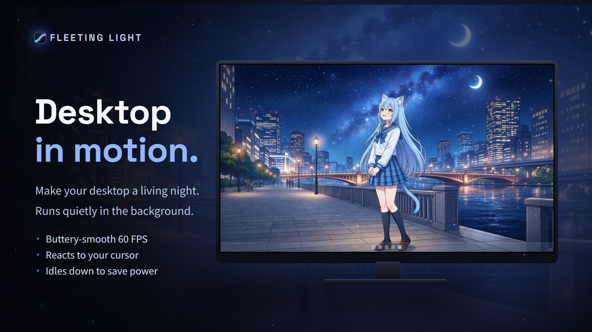
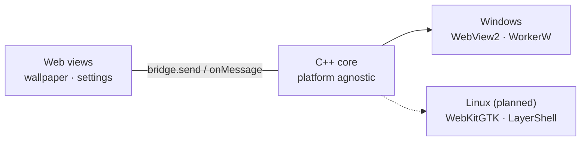

# Fleeting Light

<p align="center">
  
</p>

A live wallpaper engine built on WebView. Wallpapers are plain HTML/Canvas written by you; the core
and platform layers are C++. On Windows the page runs inside **WebView2** and is parented under the
desktop's `WorkerW` layer, so it sits behind the icons. The settings panel is a separate window,
created on demand.

Windows is the only backend today (Win32 + WebView2 + llvm-mingw). A Linux one (WebKitGTK +
X11/Wayland) is planned behind the same abstraction.



## Features

- Renders **below the desktop icons**, follows resolution, DPI and multi-monitor changes
- Wallpaper and settings panel are separate views; the panel is destroyed when closed
- One bridge for both platforms — pages never learn which host they run on
- Pauses when a fullscreen app is active, the session locks, the machine suspends, or **any window
  is maximized**; the frame freezes in place instead of disappearing
- Enable / disable hides the view entirely and restores your normal desktop
- Settings apply instantly and persist; switching wallpapers needs no restart
- Tray menu, global hotkey `Ctrl + Alt + F9`, single instance, survives Explorer restarts
- Four built-in wallpapers (see below), plus **import your own** HTML file, web folder or video
- The cursor position is streamed to the page, so wallpapers can react to the mouse

Built in: **Matrix** (glyph rain) · **Riverside** and **Skyline** (illustrated night scenes with
parallax, stars, petals) · **Neon Cat** (cyberpunk city, first-person crosshair, click to shoot
drifting bokeh orbs).

## Build

Requirements: **llvm-mingw** (clang + `mingw32-make`, put its `bin` on `PATH`), **CMake ≥ 3.20**, and
the **WebView2 Runtime** at run time (usually preinstalled on Win10/11).

```powershell
cmake -S . -B build/release -G "MinGW Makefiles" -DCMAKE_BUILD_TYPE=Release
cmake --build build/release --parallel
```

Swap the generator for `-G Ninja` if you prefer. To avoid touching `PATH`, pass
`-DCMAKE_CXX_COMPILER=<llvm-mingw>\bin\clang++.exe` and `-DCMAKE_MAKE_PROGRAM=<llvm-mingw>\bin\mingw32-make.exe`.

The WebView2 SDK is **not committed**: at configure time CMake downloads the NuGet package into
`.cache/webview2/`, copies the headers and `WebView2Loader.dll` into `third_party/webview2/`, and
generates `WebView2UUIDs.h` (MinGW needs explicit `__CRT_UUID_DECL` declarations). For offline or
pinned builds use `-DFL_WEBVIEW2_VERSION=...` or `-DFL_WEBVIEW2_LOCAL_PACKAGE=<file.nupkg>`.

Output: `build/release/fleeting-light-<version>-windows-amd64/` with the exe, `WebView2Loader.dll`
and `web/`.

**Development:** `cmake --build build/release --target run` serves the frontend straight from the
repo and opens the CDP port. Manually that is `FL_WEB_ROOT`, `FL_DEV=1` (debug port 9222) and
`FL_DEBUG=1` (verbose log).

## Usage

No main window — use the tray icon. `Ctrl + Alt + F9` toggles the panel, `Esc` closes it.
Command line: `--settings` opens the panel on start, `--autostart` is written by the autostart entry.

### Configuration

`%LOCALAPPDATA%\FleetingLight\config.json` (log next to it as `fleeting-light.log`)

```json
{
  "wallpaper": {
    "id": "matrix",
    "enabled": true,
    "fps": 60,
    "params": { "speed": 1, "intensity": 1, "density": 1 }
  },
  "app": {
    "startWithWindows": false,
    "pauseOnFullscreen": true,
    "pauseOnLock": true,
    "pauseWhenCovered": true,
    "pauseWhenSettingsOpen": false,
    "pointerTracking": true
  }
}
```

- `wallpaper.enabled` — `false` hides the view completely, revealing the desktop background
- `wallpaper.fps` — `0` follows the display, otherwise a cap from 1 to 240
- `wallpaper.id` — `matrix` for built-in wallpapers, `user:<id>` for imported ones
- `wallpaper.params` — handed to the page: `speed` 0.2–2.5, `intensity` 0.3–1.8, `density` 0.3–1.8
- `pauseWhenCovered` — pause while any window is maximized; `pauseWhenSettingsOpen` — pause while
  the panel is open (by default it only drops to 30 fps)

## Project layout

```
src/main.cpp              entry: single instance, DPI, COM, hand-off to the platform layer
src/core/                 platform agnostic: json · config · app (routing, state) · view_surface.h
src/platform/win/         win_app (loop, tray) · webview2_env/surface · desktop_host · autostart
web/shared/               bridge.js · wallpaper-runtime.js · wallpaper.css · video-template/
web/wallpapers/           built-in wallpapers + manifest.json
web/settings/             the panel: Wallpapers / Params / Behavior / About
cmake/ tools/             WebView2 SDK fetch · UUID header generation
```

## Message protocol

`bridge.send(json)` takes an object and serializes it; every message needs a `type`.

**Core → wallpaper**

| Message | Meaning |
| --- | --- |
| `init` | full state after load: `config`, `state`, `wallpaperId`, `fps`, `version` |
| `config` | configuration changed |
| `state` | `{paused, reason, settingsOpen, enabled}`; `reason` is `disabled` / `fullscreen` / `lock` / `suspend` / `settings` |
| `pointer` | `{x, y, inside, down}`, normalized to the view (0..1) |

`pointer` is sent only while `app.pointerTracking` is on, and only when the position actually
changed (~50 Hz, deduplicated). `bootWallpaper` exposes it as `state.pointer` and calls the
optional `onPointer()` hook.

**Wallpaper → core**

| Message | Meaning |
| --- | --- |
| `ready` | page loaded, core replies with `init` |
| `request_init` | ask for `init` again |
| `log` | write into the core log |
| `stats` | frame stats, only when `window.__flDebug` is set |

**Settings panel ↔ core** — same `init` / `config` / `state` (plus an `info` block: version,
platform, WebView2 version, config path, wallpaper list) and `toast`. The panel sends `update`
(deep-merge + persist, `null` deletes a key), `set_enabled`, `request_init`, and `action` with one
of: `restart_wallpaper` · `reset_config` · `open_data_dir` · `open_wallpaper_devtools` · `close` ·
`quit` · `set_autostart` · `refresh_manifest` · `import_wallpaper` · `remove_wallpaper`.

## Adding wallpapers

**Built-in** — create `web/wallpapers/<id>/index.html`, then boot the runtime:

```js
import { bootWallpaper } from '../../shared/wallpaper-runtime.js';

bootWallpaper({
  id: 'my-wallpaper',
  defaults: { speed: 1 },
  create({ ctx, width, height, dpr, params }) {
    return {
      draw(now, dt, elapsed) {},
      resize({ width, height, dpr }) {},
      setParams(next) {},
      onPointer({ x, y, down, inside }) {},   // optional
    };
  },
});
```

Add an entry to `web/wallpapers/manifest.json` (`id`, `name`, `description`, optional `preview` —
a small image relative to the folder, 256×144 is plenty). No restart needed; pick it in the panel.
The runtime already handles DPR, resizing, the frame cap, pause and pointer delivery.

**Imported** — use **+ Add wallpaper** in the Wallpapers page:

| Method | Requirement |
| --- | --- |
| HTML file | best if self-contained; only that one file is copied |
| Folder | root must contain `index.html` (or `index.htm`); suits Vite / Webpack output |
| Video | `mp4` / `webm` / `mov` / `m4v` / `mkv` |

Each imported wallpaper becomes its own folder under `%LOCALAPPDATA%\FleetingLight\wallpapers\<id>\`
and is activated immediately. Videos get a copy of the player template and play muted on a loop;
removing the wallpaper deletes that folder and the copy. Imported pages get `bridge.js` injected
automatically, and are served from `https://fleeting.local/` while built-ins use
`https://fleeting.light/`, so they never collide.

## Known limitations

- Multi-monitor: one view spans the whole virtual desktop; per-monitor views are the next step
- The wallpaper list is static `manifest.json` + a directory scan — no marketplace
- `pauseOnFullscreen` relies on `SHQueryUserNotificationState`, which can miss apps that draw their
  own borderless fullscreen
- Linux: `src/core` and `web/` are reusable; `src/platform/linux` and a POSIX `platform_env` are not
  written yet

## Notes for contributors

- One shared `CoreWebView2Environment` is the point of the architecture; `webview/webview` creates
  its own and owns a blocking loop, so only its `bridge` ergonomics were kept.
- MinGW + WebView2 needs three workarounds: explicit `__CRT_UUID_DECL` specializations (generated),
  a hand-written `EnvironmentOptions` (`<wrl/implements.h>` is missing), and
  `TargetCompatibleBrowserVersion` set to the locally installed runtime version.
- On Windows 11 `0x052C` makes `Progman` create a full-screen `WorkerW` **child**; `desktop_host.cpp`
  falls back through three levels to find it.

## License

MIT — see [LICENSE](LICENSE). The downloaded WebView2 SDK is Microsoft's, under its own license
(`third_party/webview2/LICENSE.txt`); it is not redistributed here.
